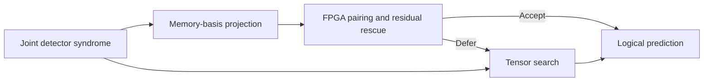

# Telescope architecture

Both main decoders combine the same distance-15 FPGA front end with a
full-syndrome tensor backend. They differ in the matching implementation.

The Surface memory-Z circuit has 3,360 joint detector bits over 15 rounds. The
FPGA profile observes 1,792 selected-basis detector bits. Prior-ordered local
pairing runs in two orders, followed by guarded three-slice residual rescue.
The default profile is `d15z-gap3-81mhz`.

A valid FPGA accept supplies the logical prediction. A defer carries the residual,
logical frame and cycle count. The host retains the original joint syndrome for
all tensor decisions. In the independent telescope, valid residuals seed a
feasible matching solution. Missing or invalid replies enter the same
full-syndrome backend.

The tensor layer conditions edge weights using complete-fault probabilities
and the opposite-basis correction. A bounded path gate selects refinement work.
Two starting orders search both logical sectors, with two refinement iterations
and joint witness scoring. Scores use physical fault witnesses to compare the
logical classes.

The independent backend uses shortest paths, weighted blossom matching,
optimality certificates and resumable path searches. Both bases and independent
path searches run concurrently. The PyMatching backend uses PyMatching 2.4.0
for correlated matching and its retained native adapter for conditioned solves.
NVIDIA GPU modes accelerate conditioning; the PyMatching version also provides
a CUDA correlated-matching implementation.

The `plain` policy returns FPGA accepts and forwards all defers. The `guarded`
policy first checks a residual cut gate before forwarding unresolved shots.
`--defer-batch` queues deferred inputs while preserving their shot identifiers.
